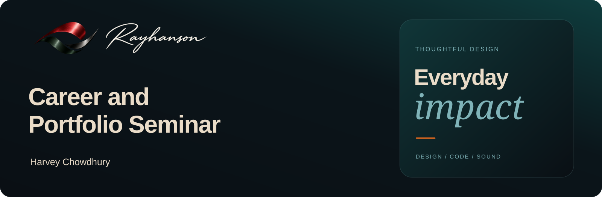

# Career, craft, and the work behind them

**Harvey Chowdhury · MTEC 4502 · City Tech · Fall 2026**

[Live portfolio](https://rayhanson.tech/) · [Assignment 1e](assignments/01-career-strategy/01e-future-modeling-and-adaptive-planning/README.md) · [Course dashboard](docs/dashboard.md) · [Project inventory](portfolio-materials/INVENTORY.md)

## My direction

I want to become an applied AI engineer who builds agentic systems, retrieval applications, and automation tools. I connect that direction with game design and development, graphic design, sound, and video. Game design was my original ambition. Building useful systems gives those interests a common foundation.

This repository records my course work, project evidence, career decisions, and revisions. My published work is at **[rayhanson.tech](https://rayhanson.tech/)**.

**Instructor:** Dr. David B. Smith · **Expected graduation:** May 2028

## Current focus

**Assignment 1e - Ready to submit.** The package includes a 593-word synthesis, three complete competency charts, 18 rubrics, annotated research, and an action plan.

[Open the assignment](assignments/01-career-strategy/01e-future-modeling-and-adaptive-planning/README.md) · [Read the PDF](assignments/01-career-strategy/01e-future-modeling-and-adaptive-planning/Harvey_Chowdhury_Assignment_1e.pdf)

Programming is level 2 and debugging is level 3. All four research records are saved in the shared Zotero collection. Assignments 1a-1d are recorded as submitted based on my confirmations.

## Selected evidence

| Direction | Work | What it contributes |
| --- | --- | --- |
| Shared agent memory | [Tesseract contribution](https://github.com/DeepExtrema/tesseract/pull/21) | Merged work on concurrent note creation and agent identity |
| Product development | [JimBro](https://rayhanson.tech/projects/jimbro/) | Scheduling, logging, local data, backups, and a character-driven interface |
| AI in creative interaction | [Gesture Particles](https://rayhanson.tech/projects/gesture-particles/) · [Virtual Theremin](https://rayhanson.tech/projects/virtual-theremin/) | Existing vision models connected to graphics and sound |
| Game development | [Wasp Dodge+](https://rayhanson.tech/projects/wasp-dodge/) | A browser game with movement, collisions, lives, and survival scoring |
| Generative visuals | [Neon Orbit Arcade](https://rayhanson.tech/projects/neon-orbit/) · [Orbit Playground](https://rayhanson.tech/projects/orbit-playground/) | Interactive motion and creative coding |
| Audio storytelling | [Studio Apartment Evening](https://rayhanson.tech/projects/studio-apartment-evening/) | A documented 3:06 multitrack sound piece |

[Full inventory and evidence limits](portfolio-materials/INVENTORY.md) · [Skills and project map](docs/skills-and-projects.md)

## Find your way

| Destination | Purpose |
| --- | --- |
| [Dashboard](docs/dashboard.md) | Progress, priorities, and submission records |
| [Assignment map](assignments/README.md) | Current numbering and archived work |
| [Course index](docs/course-index.md) | Instruction versions and source links |
| [Research](research-notes/README.md) | Source notes and Zotero status |
| [Collaboration record](reflections/ai-collaboration-log.md) | Documented tools, decisions, and contributions |
| [Instructor expectations](docs/instructor-expectations.md) | Course requirements and reported permissions |
| [Portfolio experiments](portfolio-experiments/README.md) | Presentation studies and case-study planning |
| [Setup checklist](docs/setup-checklist.md) | Course workspace setup |

## Next development direction

My planned Rust retrieval system will investigate relevance, dated facts, and conflicting memories. It is a future project, not a completed replacement for Tesseract. My Devil May Cry music video is reported complete and awaiting portfolio publication. Neither is counted as inspected implementation evidence.

## Working method

Research the problem, build a bounded version, test it, explain what changed, and revise from evidence. Project files live here or in their linked repositories. Formal submission is tracked separately from a GitHub commit.

[Professor's course repository](https://github.com/entertainmenttechnology/Smith-MTEC4502-2026F) · [GitHub](https://github.com/Rayhanson-Git) · [RayBits Gaming](https://youtube.com/@RayBitsGaming)
