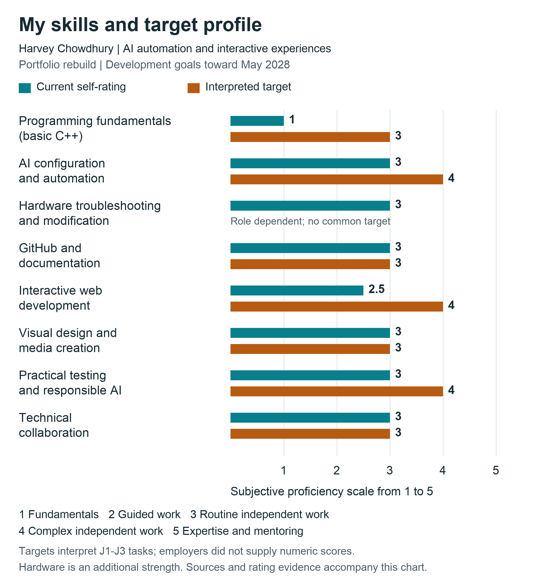
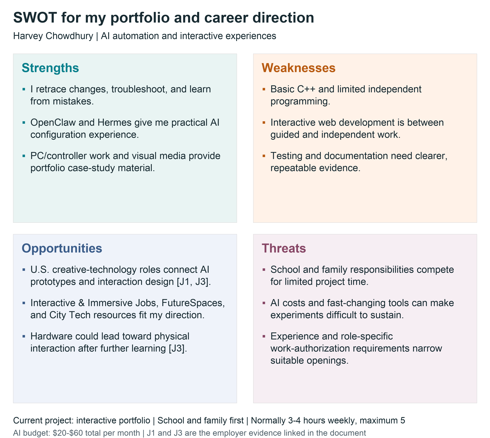

# Assignment 1c Career Strategy Visualization

Integrating Visualization into My Career Strategy

Harvey Chowdhury | MTEC 4502 | Dr. David B. Smith | October 7, 2026

## Career focus

My current priority is rebuilding my interactive portfolio so professional, course, and personal projects can be previewed in one place. My career direction is AI automation and interactive experiences, with security as a secondary interest. I want the portfolio to show working interactions and explain my contribution, including what I changed, how I checked it, and what still needs improvement. This visualization connects the gaps from Assignment 1b with evidence from job sites and employer advertisements.

School and family responsibilities come first. I normally have 3-4 hours each week for building with AI, with 5 hours as the maximum. My total AI budget is normally $20-$60 a month, including existing subscriptions. An occasional $100 month is possible if necessary, but it is an uncomfortable exception. I am looking at U.S. opportunities as an international student, so each role's work-authorization requirements need to be checked. My expected graduation is May 2028.

## Visualization platform comparison

I compared Canva, Miro, and draw.io for my SWOT matrix and skills chart.

Canva is an approachable option for quick presentation graphics. Its ready-made charts and templates reduce setup time, and I can adjust colors, typography, and layout. Real-time comments and shared editing support feedback. Free charts are available, while Pro and Business add paid features.

Miro is useful for organizing ideas with other people. Its flexible canvas and templates suit a SWOT discussion, and team members can work on the same board. The free plan has three editable boards. Paid plans add private boards and higher-resolution exports, which matter when sharing personal career notes or submitting clear images.

Draw.io gives me direct control over shapes, labels, and spacing. Its core editor is free, works without an account, and supports local files. I can exchange editable diagrams; live collaboration depends on the storage and integration used.

I chose draw.io because it fits my budget and lets me keep editable files alongside my coursework. A simple comparison chart makes each gap easy to read, and exported images can be included in the submission without another subscription.

Sources: Canva [P1], Miro [P2], and draw.io [P3].

## Job evidence from Assignment 1b

| Source | Role and level | Use in this visualization |
| --- | --- | --- |
| J1 | Kyndryl Associate Creative Technologist
Entry-level | Baseline for prototypes, APIs, accessibility, testing, and documentation |
| J2 | Amazon Design Technologist II
2+ years | Stretch benchmark for front-end implementation and portfolio samples |
| J3 | NEXT/NOW Creative Technologist AI
Level not specified | AI and interactive workflows; hardware is optional |
| J4 | Kyndryl Senior Lead
8+ years preferred | Longer-term context; excluded from the graduation target profile |

## Skills gap chart

My current profile is compared with interpreted development targets toward May 2028. The chart uses the same 1-5 scale for both series. The numeric targets are my interpretation of job-ad tasks, not employer ratings. Hardware has no common target in this digital portfolio profile.

Figure 1. Current self-assessment and target profile. Source evidence and the limits of each rating are explained on the next page.

## Evidence and target interpretation

The targets are my development goals toward May 2028, interpreted from the tasks in J1-J3. They are not numerical scores supplied by employers or a prediction that I meet every hiring requirement. J1 provides an entry-career baseline; J2 supplies a stretch benchmark; J3 shows how AI and interaction work connect. J4 is a longer-term reference. Hardware has no common target in this digital portfolio profile because the physical-computing requirement is role dependent.

1 = fundamentals; 2 = guided work; 3 = routine independent work; 4 = complex independent work; 5 = expertise and mentoring. Documentation, research, AI, and peer input can support independence when I understand the work and verify the result. These are subjective ratings, not test measurements. Web development at 2.5 represents my stated range of 2-3. The categories describe the scope of my examples, not proficiency in every related discipline.

| Skill | Now | Target | Evidence and next development need |
| --- | --- | --- | --- |
| Programming fundamentals | 1 | 3 | My C++ knowledge is very basic. I need to understand and modify the code and API data flow used in a working web prototype; these advertisements do not require C++ specifically. [J1, J2] |
| AI configuration and automation | 3 | 4 | OpenClaw, Hermes, and Obsidian memory work support my configuration rating. The next level is a repeatable integration with clear inputs, outputs, limits, and failure handling. [J1, J3] |
| Hardware troubleshooting and modification | 3 | n/a | My DualSense modification added rear controls, clicky switches, and weight. PC repairs add practical evidence. Embedded coding and microcontroller work would need separate evidence. [J3 optional] |
| GitHub and documentation | 3 | 3 | I navigate GitHub and maintain repository documents. I need clear setup, contribution, and troubleshooting notes that another person can follow, plus evidence of the Git workflow. [J1, J2] |
| Interactive web development | 2.5 | 4 | My rating sits between guided and routine independent work. I want to build responsive project previews and explain their behavior, code, accessibility, and error states. [J1, J2] |
| Visual design and media creation | 3 | 3 | I edit YouTube videos in DaVinci Resolve, photos in Lightroom, graphics in Illustrator, and art in Procreate. I need to show how those skills support usable interactive presentation. [J1, J3] |
| Practical testing and responsible AI | 3 | 4 | I retrace changes and use a separate experimental computer with limited files. I need recorded tests, repeatable checks, and clear boundaries; these precautions do not establish verified secure isolation. [J1, J3] |
| Technical collaboration | 3 | 3 | I seek peer input and support technical work with others. I need to explain decisions, record feedback, and show what changed after review of a working prototype. [J1, J2, J3] |

Programming, interactive web development, and systematic testing are the clearest gaps. AI configuration also needs to become reliable integration. A matching current and target score still needs portfolio evidence; it does not prove that my visual-media work or GitHub navigation already meets every employer task. I will start with one working project preview, document my contribution and checks, and use peer feedback to improve it before adding more features.

## SWOT matrix

Figure 2. Strengths and weaknesses describe my current position; opportunities and threats describe the environment around the project. Employer evidence: J1 and J3.

The SWOT keeps the portfolio rebuild at the center. My practical strengths give me work to explain now, while the weaknesses tell me what the rebuild should help me practice. Hardware is an additional direction to explore later. I will use free visualization tools, a narrow prototype, and peer feedback so the project fits around school and family responsibilities.

## Job site and career identity analysis

This review covers all 22 top-level records in the shared Job sites collection as checked on October 7, 2026. Some are job boards; others are guides, company portals, or learning resources. I judge usefulness against AI automation, interactive experiences, and the portfolio I am rebuilding. New York search links are starting points; my career search covers the United States. Missing or inaccessible links are identified rather than treated as verified current advertisements.

### 1 BIGMODE Publishing

Low for my current direction. This is a game-publishing resource offering development and publishing support, rather than a general job board. It does not accept games using generative AI. It is relevant to a possible original game project, but it is a weak match for my current AI automation and portfolio priorities.

[Site](https://bigmode.com/publishing) | [Zotero record](https://www.zotero.org/groups/6416274/items/4HV2X7LJ)

### 2 Extern Nintendo internship guide

Secondary lead. This third-party guide points toward Nintendo internships and gaming-related career tracks. It can help identify questions to research, but its future dates and eligibility claims include projections. I would verify an actual U.S. opening on Nintendo's official careers site before using it for an application.

[Site](https://www.extern.com/post/nintendo-internship-guide) | [Zotero record](https://www.zotero.org/groups/6416274/items/JDUKYSE3)

### 3 Indeed entry-level game design record for Akima

Uncertain until the source is recovered. The saved record names Akima and lists Huntsville, Alabama, but has no URL. Entry-level game design may connect with interactive simulation work. I cannot verify this specific advertisement, its duties, or its current status, so it is not evidence for a skills target.

[Zotero record](https://www.zotero.org/groups/6416274/items/9UJF4X2X)

### 4 gamedevmap

Useful for employer discovery. This directory maps game-development organizations and allows searches by location and company. I could identify U.S. studios and then inspect their own careers pages. It is useful for exploring interactive employers, but a directory entry does not establish an opening or an experience level.

[Site](http://www.gamedevmap.com) | [Zotero record](https://www.zotero.org/groups/6416274/items/T3P454D5)

### 5 Indeed intermediate game design record for Spellbrush

Secondary benchmark. The saved query is for intermediate game design; its metadata lists Spellbrush and San Francisco. It may provide a future game-design benchmark, but it is less direct than creative-technology roles. The linked result was inaccessible, so its current duties and availability remain unverified.

[Site](https://www.indeed.com/jobs?q=intermediate+game+design&l=&sc=0kf%3Aexplvl%28MID_LEVEL%29%3B&from=searchOnDesktopSerp&explvl=MID_LEVEL&vjk=20a3b1d8373bb0a7) | [Zotero record](https://www.zotero.org/groups/6416274/items/FNQJCMNF)

### 6 Indeed senior game design record for Epic Games

Longer-term reference. This saved query concerns senior game design, with Epic Games and Bellevue in the record metadata. It could help explore an experienced game-development path, but it is beyond my current portfolio priority. The original result was inaccessible; I cannot use it as a verified current advertisement.

[Site](https://www.indeed.com/jobs?q=senior+game+design&l=&from=searchOnDesktopSerp&vjk=be42993dbf323977) | [Zotero record](https://www.zotero.org/groups/6416274/items/EE5WJAUE)

### 7 Forage

Useful preparation resource. Forage offers free, self-paced employer-designed job simulations, including software, AI, and security topics. A small exercise could fit my available time and help me practice documenting decisions. A simulation is a learning activity, not professional employment or a guaranteed internship.

[Site](https://www.theforage.com) | [Zotero record](https://www.zotero.org/groups/6416274/items/LQ63VSKS)

### 8 FutureSpaces Jobs

High direction fit. The board connects experience design with creative technology, fabrication, and immersive installations. Examples include a creative technologist in Watertown, Massachusetts, and a tech fabricator in Santa Fe. Roles have varied seniority. It shows how digital and hardware interests can meet; exact requirements need employer verification.

[Site](https://futurespaces.com/jobs) | [Zotero record](https://www.zotero.org/groups/6416274/items/7EBJY57E)

### 9 Y Combinator Jobs

High for AI and software opportunities. YC companies advertise engineering, design, and other startup roles, including internships and experienced positions. It suits AI automation research, but I need to select U.S. locations and check each role's coding expectations. A remote label alone does not establish U.S. eligibility or student suitability.

[Site](https://www.ycombinator.com/jobs) | [Zotero record](https://www.zotero.org/groups/6416274/items/7VUKY7D2)

### 10 Authentic Jobs

High for the portfolio direction. The board focuses on designers, developers, and creative professionals, making it a useful place to search for front-end and creative work. I would select U.S. locations and junior or internship opportunities. The page's listing area requires JavaScript, so specific current vacancies were not verified in the text view.

[Site](https://authenticjobs.com/) | [Zotero record](https://www.zotero.org/groups/6416274/items/PXX2VMW5)

### 11 Stack Overflow Jobs

Useful technical benchmark. The saved link has a U.S. filter but was inaccessible. Stack Overflow's official 2024 announcement describes an Indeed-powered site for developers and technologists. That focus fits future coding research; the old announcement does not verify the saved vacancy or its present availability.

[Site](https://stackoverflowjobs.com/?co=US&jk=5e070f457a624994) | [Zotero record](https://www.zotero.org/groups/6416274/items/ECYYUYQJ)

### 12 GitHub Careers

Secondary employer-specific resource. This is GitHub's own employer portal, rather than a broad job board. It could support research into developer-platform careers, but knowing how to navigate GitHub is only one part of readiness. The saved careers page could not be retrieved, so I am not claiming a verified current vacancy.

[Site](https://www.github.careers/careers-home?) | [Zotero record](https://www.zotero.org/groups/6416274/items/43Q8NANB)

### 13 Soundlister Audio Jobs

Secondary media opportunity. Soundlister lists audio work, including game and media roles at different experience levels. It connects loosely with my editing background and limited Audition experience. I would filter for U.S. location and actual requirements; a general visual-media rating does not establish professional audio-engineering proficiency.

[Site](https://soundlister.com/category/audio-jobs/) | [Zotero record](https://www.zotero.org/groups/6416274/items/EE6RA77M)

### 14 Interactive and Immersive Jobs

High direct fit. This board specifically serves interactive technology and immersive media. U.S. examples include TouchDesigner development in Santa Monica and production work in Washington, D.C., alongside other locations and experience levels. It fits my direction well, but production-support and specialist developer roles require different evidence.

[Site](https://jobs.interactiveimmersive.io/) | [Zotero record](https://www.zotero.org/groups/6416274/items/PH8ACMYY)

### 15 ZipRecruiter immersive media search

Useful with careful filtering. The saved search starts in New York, but I can broaden my research nationally. Results mix relevant design work with unrelated duties, including a museum cafe role. I need to read the actual tasks and seniority rather than treat every immersive-media search result as a technical opportunity.

[Site](https://www.ziprecruiter.com/Jobs/Immersive-Media-Design/--in-New-York) | [Zotero record](https://www.zotero.org/groups/6416274/items/JK4B39UH)

### 16 Glassdoor immersive media search

Useful for discovery and employer context. This U.S. search combines immersive and interactive media roles with company information. Results include technical media work and management positions, so experience requirements vary. It can help compare employers, but I would verify duties and application status on the employer's page before relying on a listing.

[Site](https://www.glassdoor.com/Job/immersive-media-jobs-SRCH_KO0,15.htm) | [Zotero record](https://www.zotero.org/groups/6416274/items/AGXCJDT3)

### 17 City Tech CUNY 2X Tech resources

High for student preparation. City Tech's page brings together early-career boards, mentoring, and project-experience resources. It links to YC, Wellfound, CUNY internships, and Forage, among others. It is useful for a student balancing school and career preparation, although each external resource has its own eligibility and location rules.

[Site](https://www.citytech.cuny.edu/cuny-2x-tech/job-board-platforms.aspx) | [Zotero record](https://www.zotero.org/groups/6416274/items/FUPQXL8V)

### 18 CNX Embedded Systems Jobs

Secondary hardware bridge. This board covers embedded software, hardware, support, and manufacturing, with location and employment-type filters and U.S. examples in Maryland. It connects with my hardware interest, but PC troubleshooting is different from embedded development. I would need further programming and electronics evidence for many technical roles.

[Site](https://jobs.cnx-software.com/) | [Zotero record](https://www.zotero.org/groups/6416274/items/XWD2NEU4)

### 19 Twitch Early Career

Relevant student employer resource. Twitch describes internships and other early-career pathways, which connect with my interest in interactive and gaming media. The internship information references North American undergraduate juniors. My May 2028 graduation makes this worth checking, but a specific opening's dates, technical assessment, and eligibility must be verified.

[Site](https://careers.twitch.com/en/early-career/) | [Zotero record](https://www.zotero.org/groups/6416274/items/KTFQPKGD)

### 20 Indeed digital technologies and emerging media search

Broad secondary search. The saved link searches digital technologies and emerging media in New York. Those terms overlap my field but can produce unrelated jobs, so I would search clearer titles and expand U.S. locations. The original result was inaccessible; no specific vacancy or requirements were verified.

[Site](https://www.indeed.com/q-digital-technologies-emerging-media-l-new-york,-ny-jobs.html?vjk=c63b0a514dbf1580) | [Zotero record](https://www.zotero.org/groups/6416274/items/NN7S8X5N)

### 21 Future of StoryTelling

Useful creative reference and community. The site presents immersive storytelling work, ideas, and community resources rather than a conventional searchable job board. It can help me understand how interaction and narrative support a portfolio experience. Its value is creative direction and employer discovery, rather than immediate matching to an entry-level vacancy.

[Site](https://futureofstorytelling.org/) | [Zotero record](https://www.zotero.org/groups/6416274/items/YHQV6LEN)

### 22 Jobs in XR

Useful specialist benchmark. The board covers augmented, virtual, and mixed reality, including Unity, 3D, and computer-vision work across different locations and experience levels. It shows a possible interactive specialization. I would select U.S. opportunities and verify coding requirements, while keeping my portfolio rebuild ahead of learning another entire tool stack.

[Site](https://jobsinxr.com/) | [Zotero record](https://www.zotero.org/groups/6416274/items/E8G6K5PB)

My main search resources are Interactive & Immersive Jobs, FutureSpaces, Authentic Jobs, and Y Combinator Jobs. City Tech's CUNY 2X Tech page and Forage support preparation. I will screen for U.S. location, actual duties, experience level, and work-authorization conditions, then confirm a promising listing on the employer's site.

## Reflection

Seeing my skills beside actual job requirements made my direction clearer. I want to build AI automations and interactive experiences, and rebuilding my portfolio is the most useful place to start. My controller modification, PC troubleshooting, and OpenClaw setup show that I learn by working through problems. They also need better documentation so someone else can understand what I changed and why it worked. The chart shows that my biggest gaps are programming, interactive web development, and repeatable testing. The job sites also showed a possible connection between my hardware interests and physical interactive experiences. I want to keep that option open without distracting myself from the portfolio. School and family responsibilities limit my time, so I need small, finished improvements instead of several unfinished projects. My next step is to build a working preview, check its behavior, and explain my contribution clearly. Peer feedback will help me catch mistakes.

## Sources and research record

All sources were accessed or checked on October 7, 2026. Each job-site entry links to the saved site when available and to its shared Zotero record. The four employer advertisements are saved in the Harvey Chowdhury subcollection of the shared MTEC4502 library.

### J1 Kyndryl Associate Creative Technologist

Frisco, Texas. Entry-level. The advertisement states unrestricted U.S. work authorization and no sponsorship; personal eligibility is not assumed.

[Employer advertisement](https://kyndryl.wd5.myworkdayjobs.com/KyndrylEarlyCareers/job/Dallas-USDALFRI-Frisco-AI-HUB/Early-Career-Consult-Program---Associate-Creative-Technologist_R-66763) | [Zotero record](https://www.zotero.org/groups/6416274/items/L6497K6M)

### J2 Amazon Prime Video Design Technologist II

Culver City / San Francisco, California; Seattle, Washington. 2+ years.

[Employer advertisement](https://www.amazon.jobs/en/jobs/10507619/design-technologist-ii-prime-video) | [Zotero record](https://www.zotero.org/groups/6416274/items/A78V4Y46)

### J3 NEXT/NOW Creative Technologist AI

Chicago, Illinois company location. Not specified.

[Employer advertisement](https://nextnowagency.com/careers/creative-technologist-ai) | [Zotero record](https://www.zotero.org/groups/6416274/items/Y5J58NT5)

### J4 Kyndryl Senior Lead Creative Technologist

Dallas, Texas. Senior; 8+ years preferred.

[Employer advertisement](https://kyndryl.wd5.myworkdayjobs.com/KyndrylProfessionalCareers/job/Dallas-TX-USA/Senior-Lead-Creative-Technologist_R-64636) | [Zotero record](https://www.zotero.org/groups/6416274/items/8WANR6DV)

### Visualization platform sources

P1 [Canva Graph Maker](https://www.canva.com/graphs/) and [Canva pricing](https://www.canva.com/pricing/).

P2 [Miro pricing and free-plan limits](https://miro.com/pricing/).

P3 [Draw.io product features](https://www.drawio.com/) and [sharing diagrams](https://www.drawio.com/doc/faq/share-diagrams).

### Course and supplemental context sources

[Assignment 1c brief](https://github.com/entertainmenttechnology/Smith-MTEC4502-2026F/blob/main/assignments/01c_Integrating_Visualization.md) and [Visualization Tools and Methods guide](https://github.com/entertainmenttechnology/Smith-ET-Teaching-Resources/wiki/Visualization-Tools-and-Methods).

[Nintendo official careers](https://careers.nintendo.com/) is the employer source for verifying an opening found through the Extern guide. [Stack Overflow and Indeed partnership announcement](https://stackoverflow.co/company/press/archive/indeed-partnership) supplies historical platform context for the inaccessible saved Stack Overflow Jobs link.

[Shared MTEC4502 Zotero library](https://www.zotero.org/groups/6416274/mtec4502/library) | [Harvey Chowdhury collection](https://www.zotero.org/groups/6416274/mtec4502/collections/XT52TX5I).

