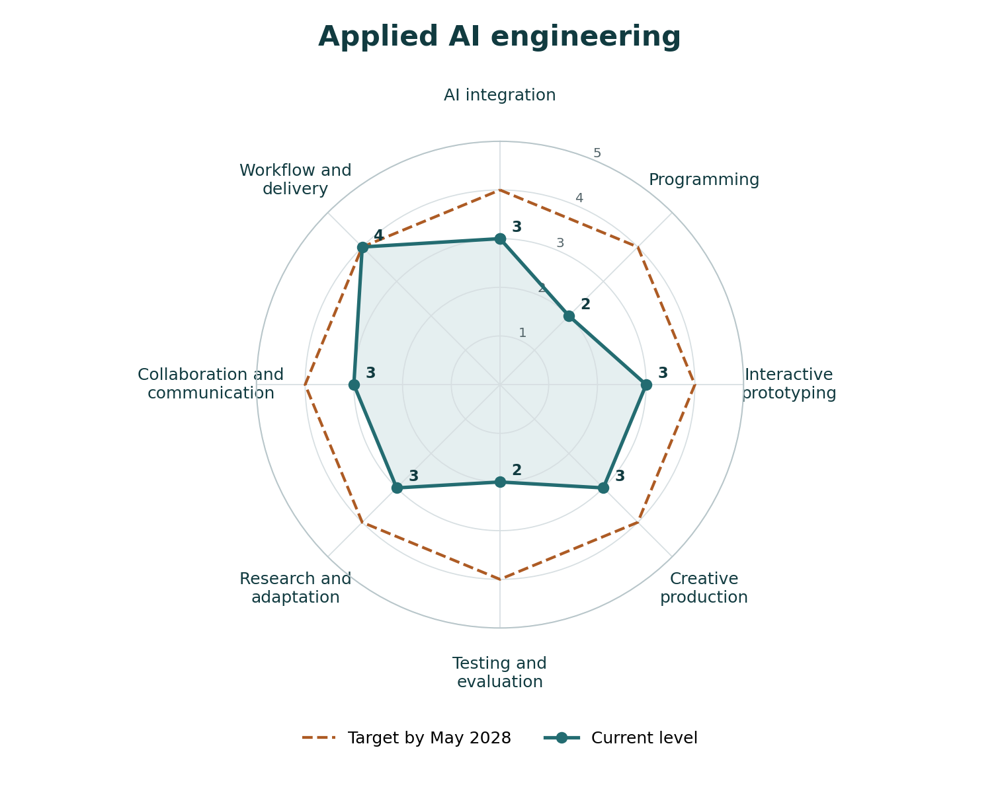
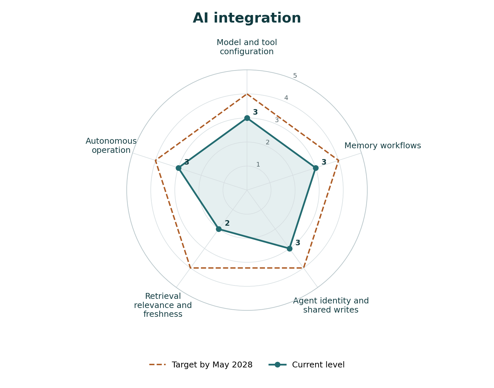
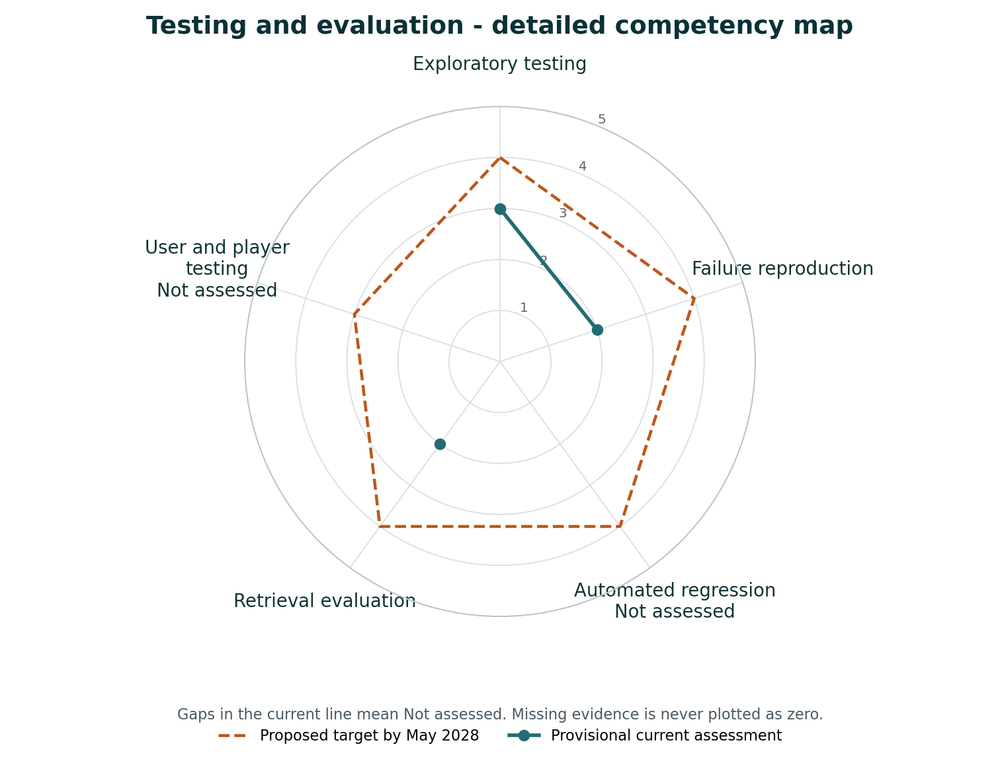

# Assignment 1e

## Future Modeling, Recursive Competency Mapping, and Adaptive Planning

Harvey Chowdhury  
MTEC 4502 - Career and Portfolio Seminar  
Dr. David B. Smith  
November 11, 2026

## 1. Future-of-work synthesis

My goal is to become an applied AI engineer who builds agentic systems, retrieval applications, and automation tools. I also want to connect that work with game design, visual design, sound, and video. Game design was my original ambition. My portfolio now includes a small browser game, gesture-controlled experiences, an audio story, and workout applications. Those projects give me a starting point, but they do not establish that I am ready for every engineering role.

In Assignment 1d, I clarified that automation and integration matter more to me than choosing a polished job title. My project evidence now makes that direction more concrete. My contribution to Tesseract gives me an example of working on an existing shared-memory system. JimBro and my creative projects show other ways I connect an idea with an interactive result. I need a strategy that develops the engineering underneath those experiences.

The World Economic Forum expects AI-related skills to grow in importance while analytical thinking, creativity, and adaptability remain valuable [S1]. Its forecast reaches 2030. For the following five to ten years, approximately 2031 to 2036, I treat changes as scenarios rather than predictions. One possibility is that applied engineers spend less time assembling standard components and more time defining problems, evaluating results, and maintaining systems. Another is that roles split between general integration work and deeper specializations in retrieval, evaluation, or interactive tools.

Anthropic's coding study shows substantial delegation to coding agents, including workflows that still involve human feedback [S2]. That supports my interest in directing systems, but the study does not prove that generated code is correct or that developers become more productive. Repetitive scaffolding, simple interface assembly, and routine asset variations may become less distinctive portfolio evidence. Debugging, data handling, evaluation, and explaining why a system behaves as it does remain priorities in my plan.

My interest in games needs the same scrutiny. GDC's survey reports both generative-AI use and strong negative sentiment, alongside employment concerns [S3]. Easier prototyping does not guarantee a good player experience or a job. I want to build beyond Wasp Dodge+, but I need to demonstrate mechanics, feedback, iteration, and testing. My creative background can help me identify useful applications, rather than assume every game task benefits from automation.

My strategy is to connect technical systems with practical and creative problems. Tesseract began with a need I could explain: several agents should share useful memory without repeated interruptions. I tested the original setup, investigated weaknesses, reviewed code, and directed changes. My merged contribution addresses concurrent note creation and agent identity [E1]. Daily maintenance, live writing, and reduced interruptions work in my setup. I still need measured results before claiming the same reliability for other users.

The vulnerable part is retrieval quality. I sometimes received outdated or less relevant memory, and I have not implemented a specific fix. My planned Rust system will investigate dated records, conflicting facts, and verified updates. Newer records cannot automatically count as more accurate. I need tests that distinguish when information was recorded from when it became valid, and retain uncertainty when a conflict cannot be resolved.

My revised chart separates integration, programming, and evaluation so that working prototypes do not hide gaps in implementation or testing. An applied-AI role example also expects programming, retrieval, reliable prototypes, and communication [S4]. I will first build a small memory-evaluation set, then a bounded Rust retrieval prototype. A later game prototype can test the same engineering habits in a creative setting. I will review the chart after each milestone instead of raising scores simply because I have added another feature.

Synthesis: 593 words.

## 2. Role-level competency map

My direction is applied AI engineering with creative and game-development applications.

These self-assessments describe my current practice on November 11, 2026. Targets are development goals for May 2028. Each score follows its behavior rubric and project evidence. Main scores describe overall capability rather than the arithmetic average of sub-skills. Testing remains at 2 because my exploratory work is stronger than my measured, repeatable evaluation.

**Scale:** 1 - Not yet demonstrated | 2 - Emerging | 3 - Basic competence | 4 - Strong and consistent | 5 - Advanced, able to teach or lead.

| ID | Competency | Current | Target | Evidence |
| --- | --- | --- | --- | --- |
| M1 | AI integration | 3 | 4 | E1, E7, E8 and student setup report |
| M2 | Programming | 2 | 4 | E1, E3, E6 and student code-review account |
| M3 | Interactive prototyping | 3 | 4 | E3, E4, E6, E9, E10 |
| M4 | Creative production | 3 | 4 | E9, E10, E11, E12 |
| M5 | Testing and evaluation | 2 | 4 | Student Tesseract stress tests, E1 and E3 test artifacts |
| M6 | Research and adaptation | 3 | 4 | Prior 1b job analysis, 1d decisions and Tesseract investigation |
| M7 | Collaboration and communication | 3 | 4 | E1, E2, E3 reflection and E12 |
| M8 | Workflow and delivery | 4 | 4 | E3, E5-E12 and repository release records |

The axes combine technical practice with research, communication, and delivery. S1 supports this mix. S4 connects integration, programming, evaluation, and communication to a concrete role. Creative production and interactive prototyping reflect my intended application area.

## 3. Recursive competency maps

### AI integration

This expands M1 into configuration, memory workflows, agent identity, retrieval quality, and autonomous operation. Retrieval freshness remains an area for improvement even though my memory workflow operates successfully.

### Testing and evaluation

This expands M5 into exploratory testing, debugging, automated regression, retrieval evaluation, and usability evaluation. My debugging score is 3. Regression, retrieval, and usability evaluation are at 2, reflecting emerging practice. Observed user testing and measured retrieval comparisons are next steps.

## 4. Competency rubrics

### M1 - AI integration

| Criterion | Description |
| --- | --- |
| Observable behavior | Connect existing models, memory, and tools into a usable application. |
| 1 | Cannot yet connect a model or tool in a guided exercise. |
| 2 | Connects one component with guidance but cannot trace the full flow. |
| 3 | Demonstrates a bounded integration and explains its input and output. |
| 4 | Reproduces integrations consistently and handles dependency failures. |
| 5 | Leads reusable integration architecture and validates adoption by others. |
| Current / target | 3 / 4 |
| Evidence | E1, E7, E8 and student setup report |
| Assessment | A merged multi-agent contribution and creative model integrations support basic integration. Wider reliability remains unverified. |
| Next action | Document one complete integration with repeatable setup and failure tests. |

### M2 - Programming

| Criterion | Description |
| --- | --- |
| Observable behavior | Read program flow and make guided changes to application code. |
| 1 | Cannot yet trace a simple program. |
| 2 | Reads basic program flow and makes guided changes. |
| 3 | Implements and explains a bounded module with checks. |
| 4 | Builds maintainable modules and handles unfamiliar requirements. |
| 5 | Designs reusable software architecture and teaches its implementation. |
| Current / target | 2 / 4 |
| Evidence | E1, E3, E6 and student code-review account |
| Assessment | My self-assessment is level 2. I inspect code and direct changes, while developing independent implementation skills. |
| Next action | Explain and implement one small Rust module with input, output, and error checks. |

### M3 - Interactive prototyping

| Criterion | Description |
| --- | --- |
| Observable behavior | Build a task or play loop with clear input, state, and feedback. |
| 1 | Cannot yet assemble an interactive sequence. |
| 2 | Creates isolated controls with incomplete state transitions. |
| 3 | Produces a working bounded flow with understandable feedback. |
| 4 | Refines complete flows through observed use and edge-case testing. |
| 5 | Leads reusable interaction patterns validated across users and projects. |
| Current / target | 3 / 4 |
| Evidence | E3, E4, E6, E9, E10 |
| Assessment | Several working project structures support basic competence. Recent human validation is not established by this inspection. |
| Next action | Observe another person completing a task and revise one confusing interaction. |

### M4 - Creative production

| Criterion | Description |
| --- | --- |
| Observable behavior | Shape visual or audio material to communicate an intended experience. |
| 1 | Cannot yet prepare a usable visual or audio asset. |
| 2 | Produces simple assets with inconsistent technical or narrative control. |
| 3 | Creates a coherent bounded piece and documents production decisions. |
| 4 | Iterates consistent media quality against audience and delivery needs. |
| 5 | Directs a cohesive production and mentors others through its pipeline. |
| Current / target | 3 / 4 |
| Evidence | E9, E10, E11, E12 |
| Assessment | Published visuals and a documented audio story support a bounded production claim. The music video remains uninspected. |
| Next action | Publish a before-and-after edit with rationale and audience feedback. |

### M5 - Testing and evaluation

| Criterion | Description |
| --- | --- |
| Observable behavior | Define success, challenge failures, and compare observed outcomes. |
| 1 | Cannot yet identify a checkable success or failure condition. |
| 2 | Explores failures and records observations informally. |
| 3 | Runs repeatable cases with expected results and records fixes. |
| 4 | Combines regression, retrieval, and usability evidence across releases. |
| 5 | Designs evaluation strategy and independently audits coverage and limits. |
| Current / target | 2 / 4 |
| Evidence | Student Tesseract stress tests, E1 and E3 test artifacts |
| Assessment | Exploratory stress testing is described. Existing automated test artifacts do not establish which evaluations the student personally ran. |
| Next action | Convert exploratory checks into a repeatable test set with expected outcomes. |

### M6 - Research and adaptation

| Criterion | Description |
| --- | --- |
| Observable behavior | Compare evidence and use it to justify a technical or career decision. |
| 1 | Cannot yet locate or identify a relevant source. |
| 2 | Collects sources but accepts claims without checking fit. |
| 3 | Uses relevant sources and explains a decision with stated limitations. |
| 4 | Triangulates conflicting sources and tests uncertain technical claims. |
| 5 | Builds reusable research methods and helps others evaluate evidence. |
| Current / target | 3 / 4 |
| Evidence | Prior 1b job analysis, 1d decisions and Tesseract investigation |
| Assessment | My career analysis and Tesseract investigation connect source evidence with decisions. |
| Next action | Compare two retrieval approaches with citations, tradeoffs, and a small experiment. |

### M7 - Collaboration and communication

| Criterion | Description |
| --- | --- |
| Observable behavior | Explain contributions, coordinate changes, and respond to feedback. |
| 1 | Cannot yet explain role or communicate a planned change. |
| 2 | Shares progress but contribution boundaries remain unclear. |
| 3 | Explains a bounded contribution and responds to review or feedback. |
| 4 | Coordinates multi-person changes with clear handoffs and documented outcomes. |
| 5 | Leads collaboration and develops practices adopted by others. |
| Current / target | 3 / 4 |
| Evidence | E1, E2, E3 reflection and E12 |
| Assessment | The merged pull request and clarified contributor role support a bounded collaboration claim, not team leadership. |
| Next action | Add a concise contribution case study linking request, review, change, and outcome. |

### M8 - Workflow and delivery

| Criterion | Description |
| --- | --- |
| Observable behavior | Package, publish, document, and maintain usable project versions. |
| 1 | Cannot yet produce a runnable or shareable project version. |
| 2 | Shares a project that depends on undocumented setup. |
| 3 | Publishes a usable version with setup and limitation notes. |
| 4 | Repeatedly delivers projects with organized source and release evidence. |
| 5 | Leads a reproducible delivery process that others can maintain independently. |
| Current / target | 4 / 4 |
| Evidence | E3, E5-E12 and repository release records |
| Assessment | Multiple live projects and dated release records demonstrate repeated delivery. Independent maintenance by other users is the next validation step. |
| Next action | Test one clean installation or recovery with another user. |

### A1 - Model and tool configuration

| Criterion | Description |
| --- | --- |
| Observable behavior | Configure a model or service and explain its operational inputs. |
| 1 | Cannot yet configure a guided model call. |
| 2 | Runs a sample configuration without explaining its options. |
| 3 | Configures a bounded service and explains key options and outputs. |
| 4 | Reproduces configuration and manages version or dependency changes. |
| 5 | Creates reusable configuration standards validated by other users. |
| Current / target | 3 / 4 |
| Evidence | E7, E8 and student Tesseract setup |
| Assessment | Creative projects integrate existing vision models. This is application evidence, not evidence of model training. |
| Next action | Reproduce configuration from a clean documented setup. |

### A2 - Memory workflows

| Criterion | Description |
| --- | --- |
| Observable behavior | Describe and implement when agents read, write, and maintain memory. |
| 1 | Cannot yet trace where a memory record is stored. |
| 2 | Reads or writes a sample note with guidance. |
| 3 | Demonstrates a bounded write, retrieval, and maintenance flow. |
| 4 | Checks persistence and recovery across repeated sessions. |
| 5 | Designs audited memory lifecycles used reliably by other teams. |
| Current / target | 3 / 4 |
| Evidence | E1 and student report of daily maintenance and live writes |
| Assessment | Daily maintenance and live memory writing work in my personal setup. Repeated run records will strengthen this evidence. |
| Next action | Record a repeatable write-to-recall journey and recovery case. |

### A3 - Agent identity and shared writes

| Criterion | Description |
| --- | --- |
| Observable behavior | Preserve contributor identity and prevent conflicting note creation. |
| 1 | Cannot yet distinguish contributors or detect a collision. |
| 2 | Labels agents manually without checking concurrent writes. |
| 3 | Implements a bounded identity or collision fix with test evidence. |
| 4 | Reproduces concurrent behavior across supported platforms and failure paths. |
| 5 | Designs shared-write contracts and validates independent multi-agent deployments. |
| Current / target | 3 / 4 |
| Evidence | E1 and its multi-agent test file |
| Assessment | Merged PR #21 addresses agent identity and note-creation collisions, with accompanying test artifacts. |
| Next action | Reproduce concurrent writes and inspect identity metadata. |

### A4 - Retrieval relevance and freshness

| Criterion | Description |
| --- | --- |
| Observable behavior | Select relevant current evidence while retaining historical context. |
| 1 | Cannot yet explain whether a retrieved item answers a question. |
| 2 | Recognizes irrelevant or stale recall but lacks a measured correction. |
| 3 | Evaluates a repeatable query set and implements one verified improvement. |
| 4 | Handles current, historical, and conflicting evidence with measured results. |
| 5 | Leads temporal retrieval evaluation with independently reviewed benchmarks. |
| Current / target | 2 / 4 |
| Evidence | Student report of stale or less relevant recall |
| Assessment | The problem was observed and explained. No specific Tesseract retrieval correction was implemented. |
| Next action | Build dated and contradictory memory cases with expected answers. |

### A5 - Autonomous operation

| Criterion | Description |
| --- | --- |
| Observable behavior | Schedule background work with clear behavior and visible failures. |
| 1 | Cannot yet run a background task reliably in a guided setup. |
| 2 | Runs a manual task but repeated execution needs intervention. |
| 3 | Demonstrates scheduled operation and explains its intended behavior. |
| 4 | Records repeated runs and recovers from a realistic interruption. |
| 5 | Designs unattended operation validated across independently maintained installations. |
| Current / target | 3 / 4 |
| Evidence | Student report of daily maintenance and fewer interruptions |
| Assessment | The personal setup is reported working. One-time setup for a wider user population is an untested usability hypothesis. |
| Next action | Record scheduled runs, exceptions, and a failure-recovery example. |

### T1 - Exploratory testing

| Criterion | Description |
| --- | --- |
| Observable behavior | Challenge a system with varied inputs and record what happens. |
| 1 | Cannot yet suggest a meaningful variation in input. |
| 2 | Tries variations without recording their purpose or result. |
| 3 | Targets a failure area and explains an observed problem. |
| 4 | Systematically explores boundaries and preserves reproducible findings. |
| 5 | Leads risk-based exploratory sessions and improves others' test coverage. |
| Current / target | 3 / 4 |
| Evidence | Student Tesseract stress-testing account |
| Assessment | The student identified interruption and retrieval problems through varied personal use. |
| Next action | Turn one exploratory session into a dated issue log. |

### T2 - Debugging

| Criterion | Description |
| --- | --- |
| Observable behavior | Investigate a defect, explain its cause, and direct or implement a correction. |
| 1 | Cannot yet describe a failure clearly. |
| 2 | Recognizes symptoms and investigates with guidance. |
| 3 | Explains a bounded problem and directs or implements a correction. |
| 4 | Diagnoses unfamiliar failures and verifies fixes across affected modules. |
| 5 | Leads complex diagnosis and teaches repeatable debugging methods. |
| Current / target | 3 / 4 |
| Evidence | E1 and my Tesseract investigation |
| Assessment | My self-assessment is level 3. I investigated Tesseract problems, inspected code, and directed changes. Retrieval freshness remains unresolved. |
| Next action | Record one defect with reproduction steps, cause, correction, and a regression check. |

### T3 - Automated regression

| Criterion | Description |
| --- | --- |
| Observable behavior | Use repeatable checks to protect behavior after changes. |
| 1 | Cannot yet identify what a regression check protects. |
| 2 | Identifies existing checks and uses assistance to work with them. |
| 3 | Adds and explains a regression case and interprets its result. |
| 4 | Maintains representative regression coverage across releases. |
| 5 | Designs evaluation infrastructure and audits weak assertions. |
| Current / target | 2 / 4 |
| Evidence | E1 and E3 automated test artifacts |
| Assessment | E1 and E3 contain regression artifacts. I place this at emerging level while building independent test execution and interpretation. |
| Next action | Personally run a focused suite and explain a failing and passing case. |

### T4 - Retrieval evaluation

| Criterion | Description |
| --- | --- |
| Observable behavior | Compare returned evidence against a defined correct or acceptable answer. |
| 1 | Cannot yet define a relevant answer for a sample query. |
| 2 | Judges individual results informally without a stable evaluation set. |
| 3 | Runs labeled queries and reports relevance or freshness outcomes. |
| 4 | Compares versions with defined measures and analyzes failures. |
| 5 | Publishes reproducible evaluations with independent review and contamination controls. |
| Current / target | 2 / 4 |
| Evidence | Student report of stale or irrelevant memory |
| Assessment | Informal recall challenges were reported. No measured relevance or freshness score is established. |
| Next action | Create 20 queries covering current facts, changes, conflicts, and unknowns. |

### T5 - Usability evaluation

| Criterion | Description |
| --- | --- |
| Observable behavior | Identify interaction difficulties and evaluate whether a flow supports its task. |
| 1 | Cannot yet identify a task or an interaction problem. |
| 2 | Identifies usability risks through interface inspection and personal use. |
| 3 | Records observed task difficulties and makes a justified revision. |
| 4 | Repeats testing across users and checks whether revisions help. |
| 5 | Leads a systematic usability evaluation with defensible outcomes. |
| Current / target | 2 / 4 |
| Evidence | E3, E4 and E6 interaction flows |
| Assessment | My prototypes include confirmation, correction, and feedback paths. The next step is observed task testing rather than informal interface inspection. |
| Next action | Observe two people completing a task and record whether a revision resolves their difficulty. |

## 5. Adaptive action plan

I will prioritize retrieval quality, programming, and repeatable evaluation through a small Rust memory project. Game development remains a connected application, with a small prototype after the retrieval milestone. My planning allowance is 3-4 project hours weekly and $20-$60 monthly total spending on model tools. I will check those limits before expanding scope.

| When | Priority | Evidence of progress | Constraint | Axes |
| --- | --- | --- | --- | --- |
| Weeks 1-2 | Define a memory evaluation set | 20 labeled queries covering current facts, older facts, contradictions, irrelevant matches, and unknown answers. Record expected evidence and output before changing retrieval. | Two weekly sessions within 3-4 project hours | M5, A4, T2, T4 |
| Weeks 3-4 | Test the current baseline | Run the same queries, record source dates and relevance judgments, and write a reproducible account of at least one stale-result failure. Record maintenance runs and interruption causes separately. | No new paid service assumed | A2, A5, T1, T4 |
| Weeks 5-8 | Build a bounded Rust retrieval prototype | Use a small synthetic dataset. Store event time, record time, source, and update links. Test verified updates, incorrect newer statements, and unresolved conflicts against the baseline. | Keep full Tesseract feature parity outside this milestone | M1, M2, A4, T3 |
| Weeks 9-12 | Validate and communicate | Ask another person to run setup or recall tasks. Document results and my contribution. Build one small game or creative interaction only if the retrieval milestone is complete and time permits. | Retain school and family priorities | M3, M7, M8, T5 |
| Each milestone through May 2028 | Review the chart | Update scores only when the rubric and evidence support a change. Recheck relevant job expectations, revise the portfolio, and select the next gap. | Reconfirm available time and budget before expansion | All axes |

At each milestone I will compare results with the baseline and update the chart against its rubrics. The memory system will retain sources and history, separate event dates from recording dates, and preserve uncertainty when conflicting statements cannot be verified.

## 6. Annotated research

### S1 - The Future of Jobs Report 2025 - Skills outlook

World Economic Forum. 2025. Core reading. Accessed November 11, 2026.

[Source](https://www.weforum.org/publications/the-future-of-jobs-report-2025/3-skills-outlook) · [Zotero record](https://www.zotero.org/groups/6416274/mtec/collections/XT52TX5I/items/GVCPT37X/collection)

The employer survey anticipates changing skill needs through 2030 and emphasizes analytical, technical, creative, and adaptive capabilities. I use it to justify a mixed competency map, while treating employer expectations as forecasts rather than guaranteed outcomes.

### S2 - Anthropic Economic Index: AI's impact on software development

Anthropic. 2025-04-28. New independent research. Accessed November 11, 2026.

[Source](https://www.anthropic.com/research/impact-software-development) · [Zotero record](https://www.zotero.org/groups/6416274/mtec/collections/XT52TX5I/items/GA3F6RRN/collection)

This analysis examines 500,000 coding interactions and distinguishes task automation from collaboration with developers. It helps me examine how implementation work could change, but it does not measure final code quality or prove productivity gains.

### S3 - GDC 2026 State of the Game Industry Reveals Impact of Layoffs, Generative AI, and More

Beth Elderkin. 2026. New independent research. Accessed November 11, 2026.

[Source](https://gdconf.com/article/gdc-2026-state-of-the-game-industry-reveals-impact-of-layoffs-generative-ai-and-more/) · [Zotero record](https://www.zotero.org/groups/6416274/mtec/collections/XT52TX5I/items/ZC4G75KF/collection)

The official survey summary describes AI use, employment pressures, and contrasting attitudes among game-industry professionals. I use it to challenge the assumption that easier production automatically means easier entry into games, while recognizing that respondents do not represent every studio.

### S4 - Applied AI Demo Engineer

Anthropic. n.d.. New role-specific source. Accessed November 11, 2026.

[Source](https://job-boards.greenhouse.io/anthropic/jobs/5455961008) · [Zotero record](https://www.zotero.org/groups/6416274/mtec/collections/XT52TX5I/items/4P6XSUXS/collection)

This employer listing combines LLM applications, retrieval, integrations, reliable prototypes, and technical communication. I use its duties as one concrete role comparison rather than an entry-level promise or a universal definition of AI engineering.

## 7. Project evidence

### E1 - Tesseract MCP contribution

**Status:** Merged contribution

Concurrent note creation and configurable agent identity. PR #21 by Rayhanson-Git merged November 4, 2026. Source and tests inspected. No new test run during the evidence inspection.

[Project](https://github.com/DeepExtrema/tesseract/pull/21) · [Repository](https://github.com/DeepExtrema/tesseract)

**Skills:** AI integration, collaboration, debugging

### E2 - Tesseract macOS/Linux contribution

**Status:** Open contribution

Portability, scheduling, and workflow guidance. PR #10 itself is not marked merged. Similar upstream changes must not be attributed solely from this PR.

[Project](https://github.com/DeepExtrema/tesseract/pull/10) · [Repository](https://github.com/Rayhanson-Git/tesseract-mcp-MacOS)

**Skills:** Workflow, research, integration

### E3 - JimBro

**Status:** Published

Integrated scheduling, workout logging, local storage, backups, and animated character. Core source and live entry screen inspected. November 10 QA record reports 49 domain checks and deployed Chromium journeys. Those checks were not rerun during the evidence inspection.

[Project](https://rayhanson.tech/projects/jimbro/) · [Repository](https://github.com/Rayhanson-Git/Harvey-Chowdhury-MTEC3200/tree/release/jimbro-web)

**Skills:** Product development, delivery, documentation

### E4 - GymLog

**Status:** Published prototype

Post-set logging, editable values, confirmation, and correction paths. Sample data lasts for the page session. Portfolio describes participant testing as a next validation step.

[Project](https://rayhanson.tech/projects/gymlog/) · [Repository](https://github.com/Rayhanson-Git/Rayhanson-Git.github.io/blob/main/projects/gymlog/prototype.html)

**Skills:** UX, prototyping, iteration

### E5 - LeaveBy

**Status:** Published

Backward scheduling with input validation and date calculations. Source and live form inspected. Uses user estimates rather than live transit information.

[Project](https://rayhanson.tech/projects/leaveby/) · [Repository](https://github.com/Rayhanson-Git/Harvey-Chowdhury-MTEC3200)

**Skills:** Problem definition, application logic

### E6 - Wasp Dodge+

**Status:** Published browser game

Movement, collision detection, four lives, cooldown, scoring, and restart logic. Source and live game menu inspected. Full playthrough and player testing were not performed during the evidence inspection.

[Project](https://rayhanson.tech/projects/wasp-dodge/) · [Repository](https://github.com/Rayhanson-Git/MTEC1201_Harvey/tree/main/Assignments/Midterm_Final_HarveyC)

**Skills:** Game development, interaction

### E7 - Gesture Particles

**Status:** Published

MediaPipe landmarks mapped to Three.js particle behavior. Source and live interface inspected. Camera-based behavior was not tested during the evidence inspection. Integrates an existing model.

[Project](https://rayhanson.tech/projects/gesture-particles/) · [Repository](https://github.com/Rayhanson-Git/Gesture-Particles)

**Skills:** Computer vision integration, creative coding

### E8 - Virtual Theremin

**Status:** Published

Hand tracking mapped to pitch, volume, bass, and drum triggers. MediaPipe and Tone.js integration inspected. Live start screen opened. Camera and audio performance were not tested.

[Project](https://rayhanson.tech/projects/virtual-theremin/) · [Repository](https://github.com/Rayhanson-Git/Virtual-Theremin)

**Skills:** Interactive audio, integration

### E9 - Neon Orbit Arcade

**Status:** Published

Particles, portals, forces, and Calm/Chaos modes. Source and rendered live canvas inspected.

[Project](https://rayhanson.tech/projects/neon-orbit/) · [Repository](https://github.com/Rayhanson-Git/neon-orbit-final)

**Skills:** Simulation, creative coding

### E10 - Orbit Playground

**Status:** Published

Orbiters, changing palettes, adjustable speed, and input response. Source and rendered live canvas inspected.

[Project](https://rayhanson.tech/projects/orbit-playground/) · [Repository](https://github.com/Rayhanson-Git/orbit_playground)

**Skills:** Generative visuals, interaction

### E11 - Studio Apartment Evening

**Status:** Published audio

Audio storytelling and multitrack editing in Adobe Audition. Published 186-second audio loaded and session screenshot inspected. The page credits 11 self-recorded sounds. No listening assessment was performed during the evidence inspection.

[Project](https://rayhanson.tech/projects/studio-apartment-evening/) · [Repository](https://github.com/Rayhanson-Git/Rayhanson-Git.github.io/tree/main/projects/studio-apartment-evening)

**Skills:** Creative production, storytelling

### E12 - Portfolio website

**Status:** Published

Case studies, visual identity, responsive navigation, and project presentation. Nine case studies and core portfolio interaction code inspected.

[Project](https://rayhanson.tech/) · [Repository](https://github.com/Rayhanson-Git/Rayhanson-Git.github.io)

**Skills:** Communication, visual design, delivery

### E13 - Devil May Cry music video

**Status:** Completed, student-reported

Video editing and game-related storytelling. Not yet published on the portfolio. Media and editing timeline not inspected.

**Skills:** Potential creative-production evidence

### E14 - Rust retrieval system

**Status:** Planned

Time-aware memory, conflict resolution, and retrieval evaluation. No working Rust implementation established in this conversation.

**Skills:** Growth project, not current competency evidence

## 8. Further research: weight-space programming

I am beginning to study weight-space programming because I want to understand how AI engineering could develop beyond connecting existing models and tools. MIT CSAIL researchers report early experiments in which a language model reads, writes, or edits another neural network's parameters directly [S5]. If this approach becomes reliable, it could create opportunities involving model inspection, targeted modification, and evaluation.

The Alan Turing Institute reproduces some results but finds important limits in generalization and interpretation [S6]. That makes the work relevant to my learning plan. I want to strengthen my understanding of neural-network architecture and weight matrices, then attempt a small reproducible experiment comparing behavior before and after an edit. This is a research interest and future learning goal, not an implementation I have completed.

### S5 - Sparks of Weight-Space Programming: LLMs can natively read & write neural network weights

Rikiya Takehi, Jayden Teoh, Alex Zhang, and Omar Khattab. 2026-11-02. Research blog post. Accessed November 11, 2026.

[Source](https://rikiyat.github.io/blog/weight-space-programming/) · [Zotero record](https://www.zotero.org/groups/6416274/mtec/collections/XT52TX5I/items/QQCUXHW8/collection)

MIT CSAIL researchers report early experiments in which a language model directly reads, writes, or edits another neural network's weights. I am studying this work as a possible direction for AI engineering, while treating its experimental results as an invitation to investigate rather than proof of general reliability.

### S6 - Replicating Weight-Space Programming: Writing and Reading Neural Network Weights with Frontier LLMs

Roksana Goworek, Alexander Hickey, Federico Nanni, and Martin O'Reilly. 2026. Working paper and institutional summary. Accessed November 11, 2026.

[Source](https://www.turing.ac.uk/news/publications/replicating-weight-space-programming-writing-and-reading-neural-network-weights) · [Zotero record](https://www.zotero.org/groups/6416274/mtec/collections/XT52TX5I/items/KCGCKWXX/collection)

The Alan Turing Institute reproduces some weight-reading and weight-writing results while identifying limits in generalization and interpretation. I use this comparison to frame my interest around reproducible experiments and evaluation rather than assume that the original demonstrations establish broad model understanding.
