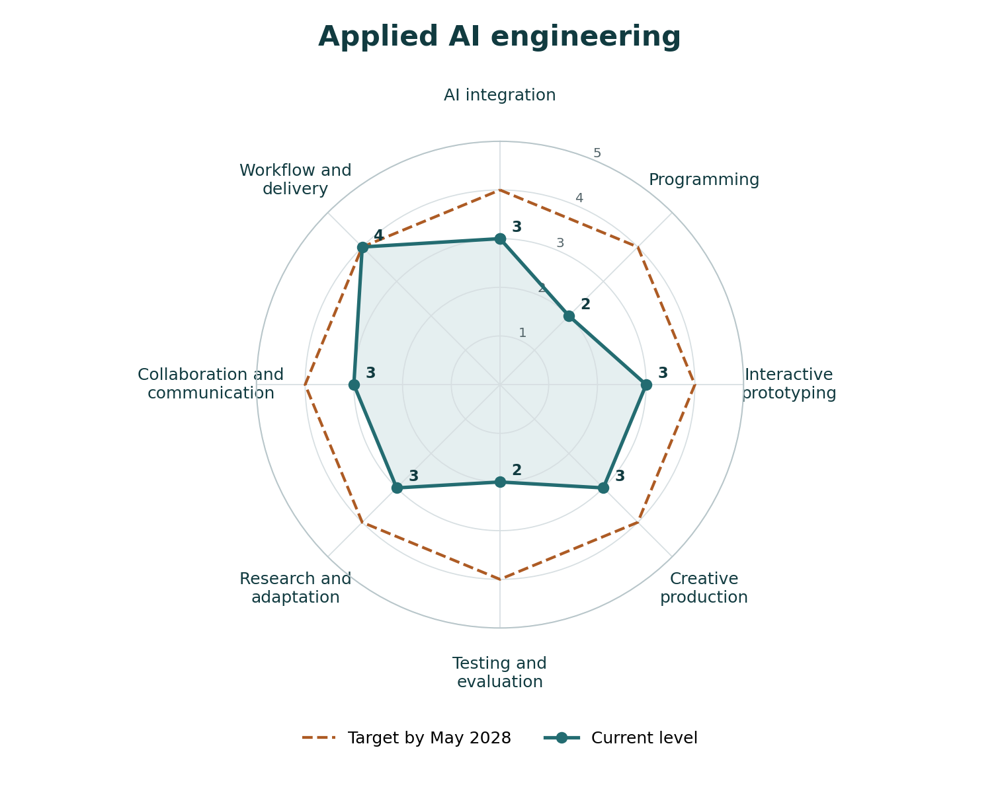

# Assignment 1e

**Future Modeling, Recursive Competency Mapping, and Adaptive Planning**

**Progress: Ready to submit.** November 11, 2026.

[Read the assignment](Harvey_Chowdhury_Assignment_1e.md) · [Open the PDF](Harvey_Chowdhury_Assignment_1e.pdf) · [Submission checklist](submission-checklist.md)

| Component | File |
| --- | --- |
| Synthesis, charts, rubrics, and plan | [Complete assignment](Harvey_Chowdhury_Assignment_1e.md) |
| 18 competency rubrics | [Scales and evidence](competency-rubrics.md) |
| Four annotated sources and saved Zotero records | [Research](source-notes.md) |
| Project evidence | [Evidence register](evidence-register.md) |
| Growth milestones | [Action plan](action-plan.md) |
| Chart data | [JSON](data/competencies.json) · [CSV](data/ratings.csv) |

[Assignment instructions](https://github.com/entertainmenttechnology/Smith-MTEC4502-2026F/blob/main/assignments/01e_Future_Modeling_and_Adaptive_Planning.md) · [Radar guide](https://github.com/entertainmenttechnology/Smith-MTEC4502-2026F/blob/main/resources/radar_chart_construction_and_competency_assessment.md)

[Career strategy](../README.md) · [Dashboard](../../../docs/dashboard.md)
